I build AI systems that keep working when nobody is watching. I spent three years in research at Fractal Analytics on multi-agent systems that work on a problem for 24 hours straight; one of them ranked first on OpenAI's MLE-Bench when we submitted it. Then at Mirian AI I took an AI system to paying customers in eight weeks, as the only engineer on it.

## Work

  
  

  
  

  
  

## What the work taught me

- **A judge from the same family is a character witness.** I built a judge to check an agent's code before it ran. It did not help, because it was the same model family as the agent it was judging. On a different family, it worked.
- **You cannot talk to every model the same way.** GPT models did best with the context first and the instructions after. Claude models followed an instruction better when it came with the reason. I know people like both.
- **Sometimes the right instruction is "check your work less".** We had about 24 hours per problem. Lighter validation meant a slightly noisier score and many more experiments. More ideas were worth more than steadier scores.
- **Show the agent its best and its worst.** An agent learns little from a list of everything it has tried. Each new attempt saw one very good solution, one very bad one, and a short summary of the rest.
- **If you cannot look at it afterwards, do not ship it.** Trace every model call. The alternative is a séance.

## How I got here

## Away from the keyboard

More than 200 books read, and a to-read list almost as long ([my shelves](https://www.goodreads.com/user/show/71110876-kirubananth-sankar)). A black Honda CB350; the last ride was Bangalore to Coorg. I travel mostly to eat.

## Find me

[Website](https://kirubanath.github.io) · [LinkedIn](https://www.linkedin.com/in/kirubananth-sankar/) · [Google Scholar](https://scholar.google.com/citations?hl=en&user=ZL0v87wAAAAJ) · [The paper](https://proceedings.mlr.press/v293/chopde25a.html)

An agent drafted this page. A human approved it. That is the whole philosophy.
